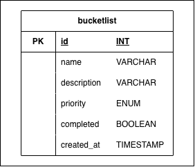
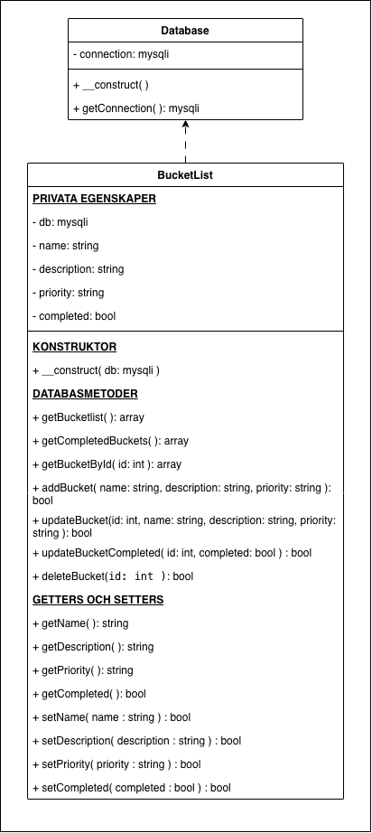

# Laboration 2 - Innan jag dör... ☠️

En dynamisk bucketlist-webbplats skapad som en del av **Laboration 2 – Introduktion till PHP** i kursen Webbutveckling för WordPress vid Mittuniversitetet.

Webbplatsen låter användaren samla mål och drömmar som de vill uppnå under sin livstid.

---

## Syfte 🏁

Syftet med uppgiften har varit att omsätta kursens kunskaper i praktiken genom att skapa en webbplats med HTML, CSS, objektorienterad PHP och databasanslutning.

---

## Funktioner 🛠️

- Visa mål sorterade efter prioritet.
- Lägga till nya mål med namn, beskrivning och prioritet.
- Redigera och radera befintliga mål.
- Markera mål som genomförda och visa dem separat.
- Återaktivera genomförda mål.
- Validering av formulär med tydliga felmeddelanden.
- Responsiv design för olika skärmstorlekar.

---

## Tekniker 🧩

Projektet är byggt med:

- HTML5
- CSS
- JavaScript
- PHP (objektorienterad programmering)
- MySQL/MariaDB
- Git och GitHub

---

## Installation 🚀

1. Klona repot till en lokal webbserver med stöd för PHP och MySQL/MariaDB.
2. Skapa en databas.
3. Kopiera `includes/config.example.php` till `includes/config.php`.
4. Ange dina databasuppgifter i `config.php` och kontrollera att `$devMode` är inställt på `true` vid lokal utveckling.
5. Kör `db/install.php` för att skapa databastabellen.
6. Öppna webbplatsen via din lokala webbserver.

**Observera:** `config.php` innehåller databasuppgifter och är därför exkluderad från versionshantering via `.gitignore`.

---

## Projektstruktur 🧶

```text
.
├── assets
│   ├── css
│   │   └── style.css
│   ├── images
│   │   └── bakgrund.JPG
│   └── js
│       └── main.js
├── db
│   ├── install.php
│   └── reset.php
├── docs
│   ├── ER-diagram.drawio
│   ├── ER-diagram.png
│   ├── UML-diagram.drawio
│   └── UML-diagram.png
├── includes
│   ├── bucket-form.php
│   ├── completed-dialog.php
│   ├── config.example.php
│   ├── delet-dialog.php
│   ├── footer.php
│   ├── header.php
│   └── main-menu.php
├── models
│   ├── BucketList.class.php
│   └── Database.class.php
├── ai.php
├── bucketlist.php
├── index.php
└── README.md
```

---

## Dokumentation 📑

### ER-diagram


### UML-diagram


---

## Publicerad webbplats 🌐

Läggs till efter publicering.

---

## AI-användning 🤖

GitHub Copilot och ChatGPT har använts som stöd under utvecklingen, bland annat för felsökning, diskussioner om kod och förklaringar av programmeringskoncept.

En mer utförlig redovisning av AI-användningen och egna erfarenheter finns på webbplatsens AI-sida.